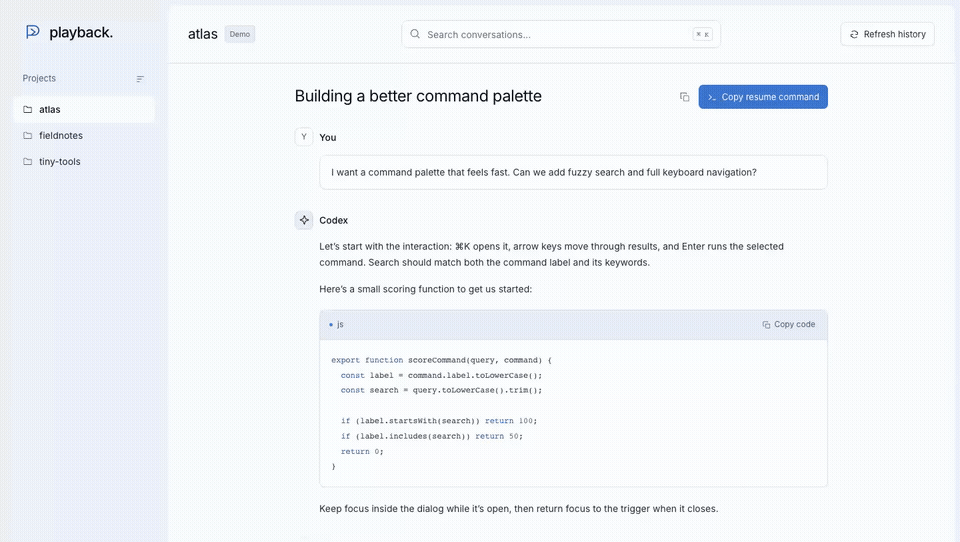

# Codex Playback

Find past Codex conversations, read the messages and code, and pick up where you left off from your terminal. Playback opens your local history in a browser, organized by project, with search and a copyable resume command that stays within reach as you scroll.

<!-- playback-demo:start -->

[](https://github.com/Savio09/codex-playback/blob/main/docs/media/demo.mp4)

*Choose a project, search, copy code, and copy a resume command. Recorded with synthetic history.*

<!-- playback-demo:end -->

## Install

Requires **Node.js 22 or newer** and npm.

```sh
npm install -g codex-playback
```

## Launch

```sh
codex-playback
```

Playback opens your default browser on **localhost** at an address such as `http://127.0.0.1:4317`. It chooses an available port and prints the full access link in your terminal. Keep that terminal running; press **Ctrl+C** to stop the app.

To use a fixed port:

```sh
codex-playback --port 4317
```

You can also run it without a permanent installation:

```sh
npx codex-playback
```

## Update

Stop Playback with **Ctrl+C**, update the global installation, then launch it again:

```sh
npm install -g codex-playback@latest
codex-playback
```

Check your installed version with `codex-playback --version`.

If you use npx, request the latest release explicitly:

```sh
npx codex-playback@latest
```

See the [changelog](https://github.com/Savio09/codex-playback/blob/main/CHANGELOG.md) for new features and fixes.

## Use it

1. Choose a project in the sidebar and search for a conversation.
2. Read the transcript or copy a code block.
3. Click **Copy resume command** and paste it into your terminal to continue the chat.

The resume button floats near the bottom of the page when you scroll past its header. Archived chats, full-transcript copying, and macOS/Linux or PowerShell commands are also supported.

Browsing only needs saved history on this computer. Resuming requires the Codex CLI to be installed and signed in. Playback reads your default Codex profile; use another with:

```sh
codex-playback --codex-home /path/to/profile
```

## ChatGPT history

You can also browse an extracted ChatGPT export:

```sh
codex-playback --chatgpt-export /path/to/conversations.json
```

Imported ChatGPT conversations continue in a **new Codex session** using the exported transcript as context. Native Codex conversations resume their original session.

## Privacy

Browsing stays on your computer and does not modify your history. Playback has no telemetry or external font/script requests. Continuing a conversation uses your existing Codex provider configuration.

## Contributing

Contributions are welcome. See the [contribution guide](https://github.com/Savio09/codex-playback/blob/main/CONTRIBUTING.md) for development and testing instructions.

## License

[MIT](https://github.com/Savio09/codex-playback/blob/main/LICENSE). Bundled Inter fonts use the [SIL Open Font License](https://github.com/rsms/inter/blob/master/LICENSE.txt).
